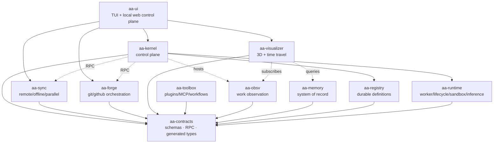
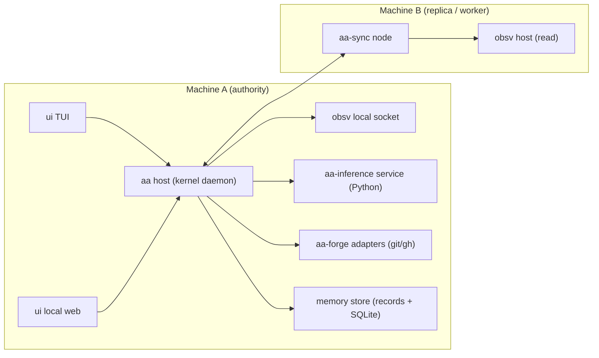
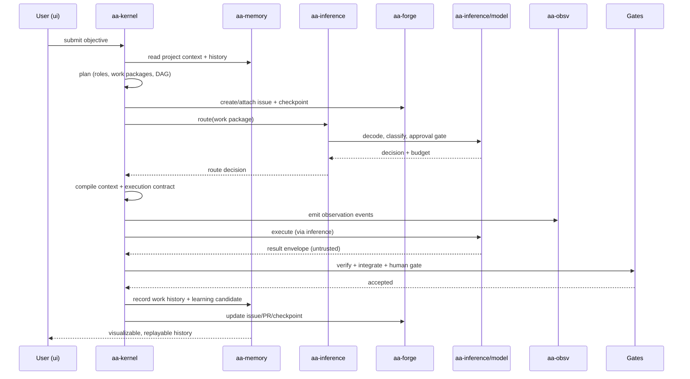
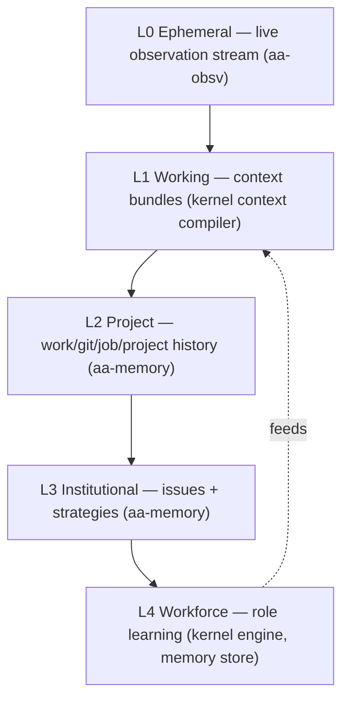

# aa

**aa** is an end-to-end agentic terminal: a modular, local-first platform for
observing, planning, executing, verifying, and continuously learning from
software engineering work performed by humans and AI agents.

A deterministic control plane owns state and coordination. Models are workers
behind a router. Every unit of work is observable, replayable, and attributable.

## Status

The v1 core is implemented and composed in the `app/` daemon:

- contract schemas, RPC, and Go/TypeScript/Python bindings;
- a control-plane HTTP/JSON API with projects, work packages, approvals, nodes,
  tools, observations, visualizer, registry, and lifecycle reads;
- CLI, TUI, and read-only web console surfaces;
- deterministic scheduler, allocator, gates, runtime sandbox, result intake,
  memory store/repo/retrieval, registry definitions, toolbox, single-node sync,
  observation, and visualizer core.

The forge lifecycle/template libraries, the optional Python inference sidecar,
and the GitHub adapters exist in the repository but are not all wired into the
default v1 daemon. See [current state](docs/current-state.md) for the precise
boundary.

Still in progress or deliberately deferred: real authn/authz, release packaging,
performance/chaos testing, the Wails/React/Three visualizer surface, and product
media. See [known limitations](docs/current-state.md#known-limitations).

## Quickstart

Requirements: Go 1.26. Python 3.12+ is only needed for the inference service;
Node 20+ is only needed for the TypeScript contract bindings.

```sh
git clone https://github.com/greadee/aa.git
cd aa

# deterministic composition check; no model or network required
go run ./app selfcheck
```

Run the control plane and the console:

```sh
# terminal 1: loopback control plane
AA_CONTROL_TOKEN=dev-token go run ./app serve

# terminal 2: text console
go run ./app console --token dev-token

# or the read-only web surface
go run ./app console --web --token dev-token
```

The console can also run fully offline against the deterministic fake control
plane:

```sh
go run ./app console --fake
```

`aa serve` binds `127.0.0.1:7100` by default. When `--token` (or
`AA_CONTROL_TOKEN`) is set, every path except `/api/v1/health` requires that
bearer token. **An empty token disables the check**, so always set a token
outside local development. Loopback is not authentication. `AA_ROOT` selects the
state directory (default `.aa`).

## What you can do today

| Persona | Actions |
|---|---|
| Engineer | Create and inspect projects, submit work packages, approve or reject human gates, inspect assignments, graphs, and results |
| Operator | Run `selfcheck`, `serve`, and the console; inspect nodes, tools, and sync status; inspect registry definitions |
| Auditor | Replay observation sessions, browse memory and reports, inspect the visualizer read model |

The shipped surfaces are the CLI, TUI, and read-only web console. Execution is
opt-in and disabled by default.

## Architecture

### Architecture overview

The module-level composition is the shared map of responsibilities.



### Runtime and deployment view



- The **host** is the kernel daemon. It owns the store, the scheduler, the observation journal, and the control-plane API.
- **aa-inference** runs as a local sidecar process reached over RPC; it is the only Python module.
- **aa-sync** establishes paired, authenticated links between machines and moves work packages, artifacts, and offline changes.
- Exactly one machine holds execution **authority** for a project in v1. Others are read-only replicas and workers.

### Primary end-to-end flow



### Memory and event layering



Each layer has a different authority, retention, and promotion rule. Only
`aa-memory` is canonical and permanent.

The [current diagrams](docs/architecture/diagrams.md) show the as-built
composition, contracts, work flow, control-plane deployment, and end-to-end
sequence. The [architecture record](docs/architecture/README.md) holds the target
design, decisions, and phase plan. The
[architecture index](docs/index/architecture.md) links the current maps and ADRs.

## Modules

| Module | Responsibility |
|---|---|
| [`app`](app/main.go) | Composition root and control-plane daemon |
| [`contracts`](docs/modules/contracts/README.md) | Single source of truth for schemas, RPC, and generated bindings |
| [`registry`](docs/modules/registry/README.md) | Durable definitions: roles, models, teams, capabilities, routines, policies |
| [`obsv`](docs/modules/obsv/README.md) | Product-neutral work observation: protocol, emitter, transport, journal, reports |
| [`kernel`](docs/modules/kernel/README.md) | Control plane: planning, allocation, scheduling, gates, job learning |
| [`runtime`](docs/modules/runtime/README.md) | Execution mechanics: worker, lifecycle, sandbox, intake, inference |
| [`memory`](docs/modules/memory/README.md) | System of record: work/project history, retrieval, promotion |
| [`sync`](docs/modules/sync/README.md) | Remote sync, transfer, identity, and multi-machine coordination |
| [`forge`](docs/modules/forge/README.md) | Git and GitHub orchestration: issues, PRs, checkpoints, audits, releases |
| [`toolbox`](docs/modules/toolbox/README.md) | Tool, plugin, and MCP registry plus configurable workflow runtime |
| [`visualizer`](docs/modules/visualizer/README.md) | Time-travel replay, deterministic layout, session browsing |
| [`ui`](docs/modules/ui/README.md) | Unified interface: CLI, TUI, and read-only web surfaces |

## Media needed

Product screenshots, GIFs, and demo video are not committed yet. Please provide:

- a terminal capture of `aa selfcheck`;
- a TUI capture of `aa console --fake`;
- a read-only web console capture from `aa console --web`;
- a short demo video or GIF;
- optionally, a social-preview image.

The exact commands and format guidance are in
[docs/media/README.md](docs/media/README.md). The README will link to the media
once the owner-provided assets are available.

## Documentation

- [Documentation entry point](docs/index/README.md)
- [Current state and limitations](docs/current-state.md)
- [Architecture](docs/architecture/README.md)
- [Current diagrams](docs/architecture/diagrams.md)
- [Module index](docs/index/modules.md)
- [Phase and sprint index](docs/index/phases.md)
- [GitHub process](docs/github-os/README.md)

## Contributing

Read [CONTRIBUTING.md](CONTRIBUTING.md) and the
[definitions of done](docs/github-os/definitions-of-done.md). Implementation
lands on `dev` before `main`; every issue and PR links its validation evidence.

## License

[MIT](LICENSE.md).
