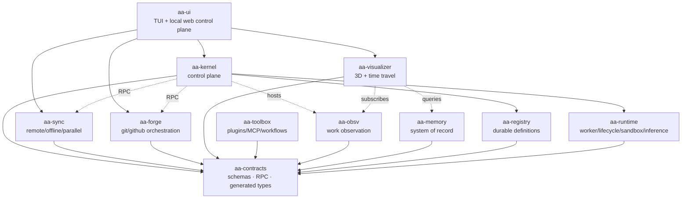
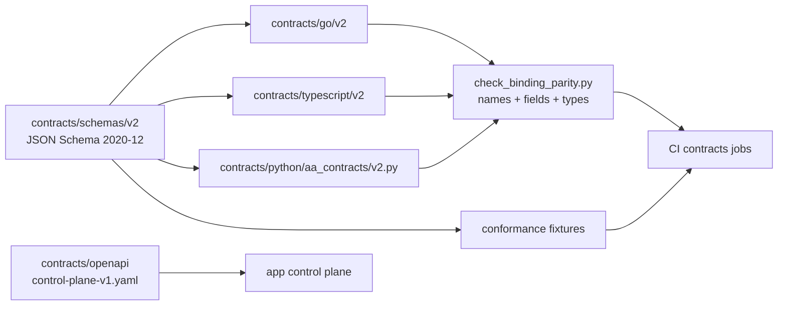
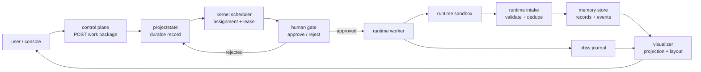
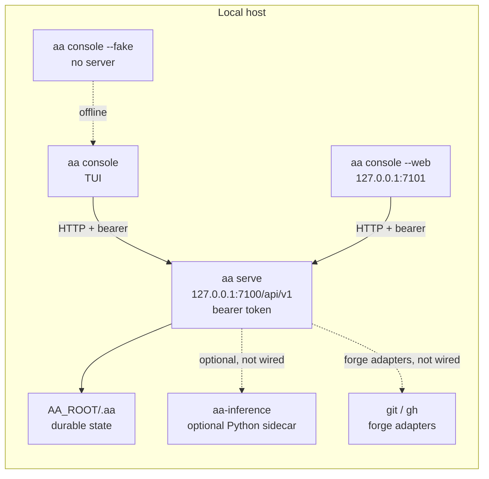
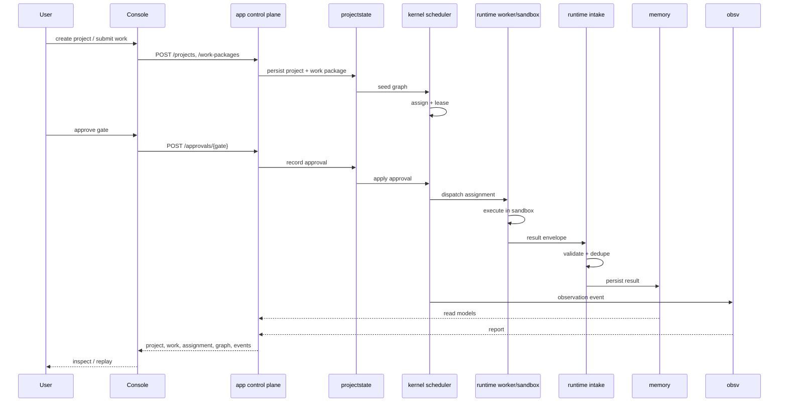

# Current architecture diagrams

These diagrams describe the **as-built** v1 composition, not the target roadmap.
The target design and decision record is [README.md](README.md); today's behavior
boundary is [current-state.md](../current-state.md).

Source of truth for wiring: [`app/main.go`](../../app/main.go).

## 1. Current composition map

The module-level composition is the shared map used by the README. The detailed
wiring lives in [`app/main.go`](../../app/main.go) and the module directives.

Text fallback: ui sits over the kernel and the world adapters; kernel hosts
observation; memory and obsv back visualization; every module depends on
contracts; kernel dispatches to runtime and registry.

## 2. Contracts and generated bindings

Text fallback: one schema source generates Go, TypeScript, and Python; OpenAPI
describes the control plane; fixtures and the parity gate enforce conformance.

## 3. Primary work data flow

Text fallback: work is recorded before dispatch; the scheduler holds an assignment
and lease; a human gate decides; the runtime executes in a sandbox; intake
validates results before memory; observation feeds visualization.

## 4. Control-plane deployment

Text fallback: one local daemon owns state and serves loopback HTTP; both console
surfaces use the same client; the fake client bypasses the daemon for offline
development; inference and forge are adapters/optional services, not authorities; they are
not wired into the default v1 daemon.

## 5. End-to-end deterministic sequence

Text fallback: create project → submit work → approve gate → dispatch → execute →
intake → persist → observe → read back in the console.

## Related

- [Current state](../current-state.md)
- [Target architecture](README.md)
- [Control-plane OpenAPI](../../contracts/openapi/control-plane-v1.yaml)
- [Module index](../index/modules.md)
